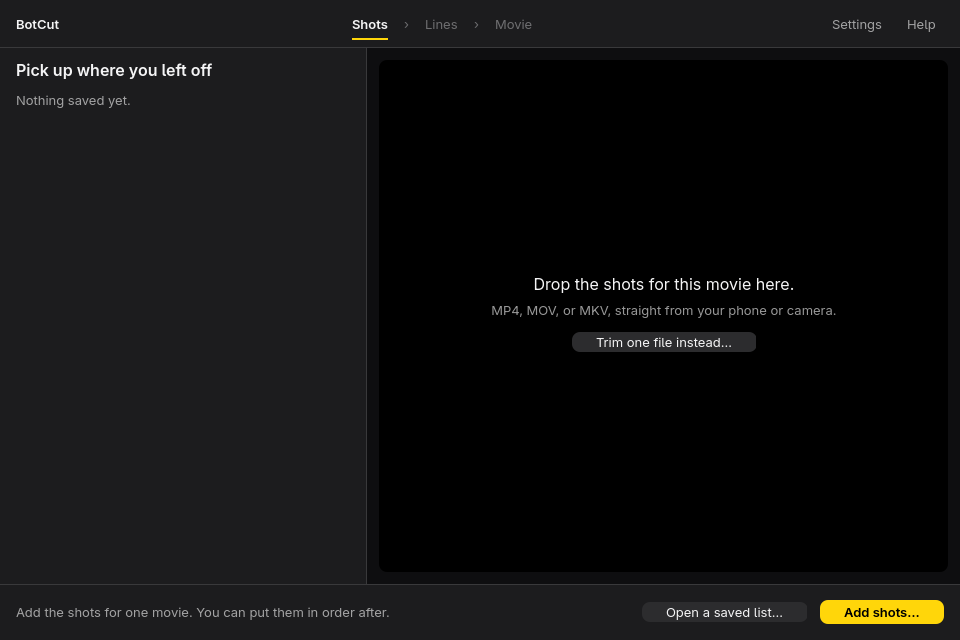
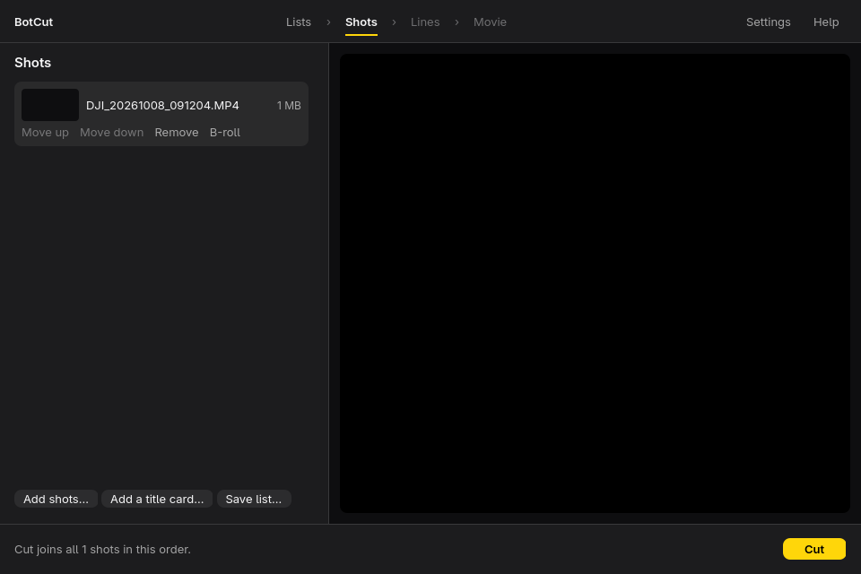
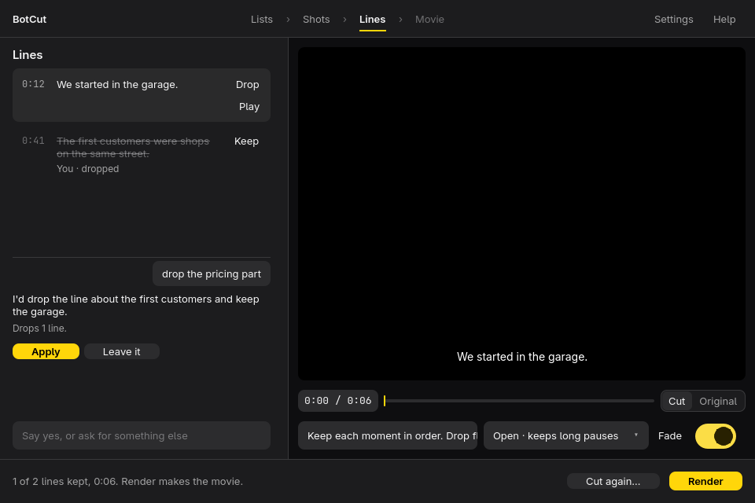
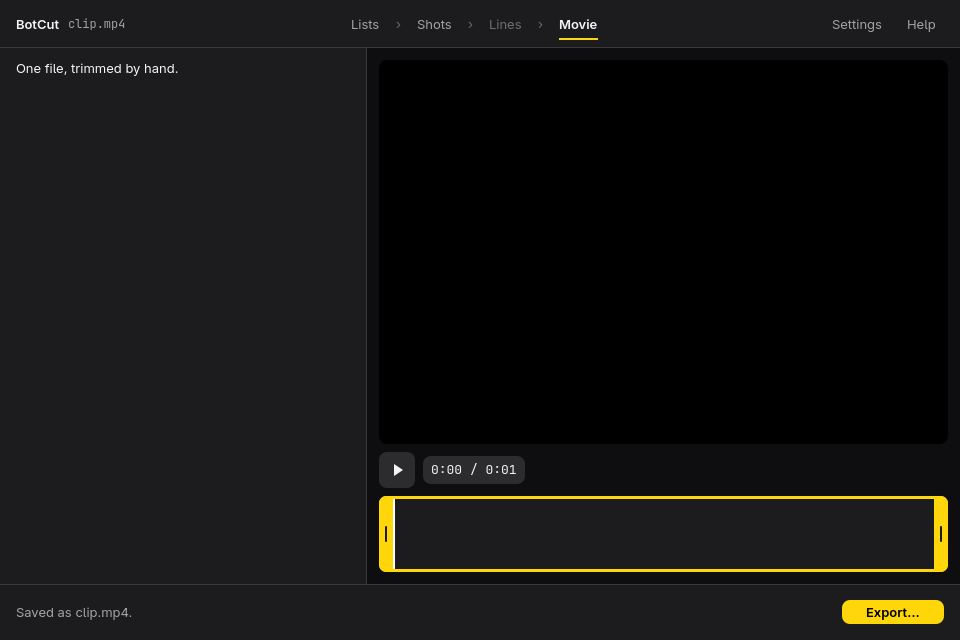
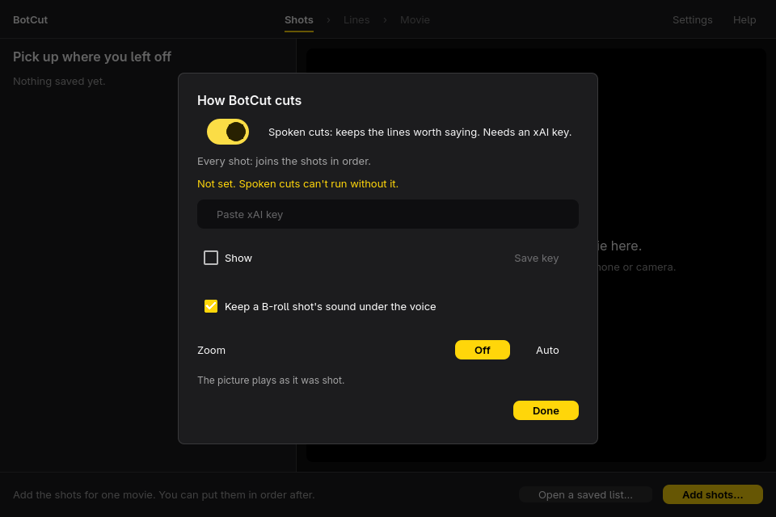
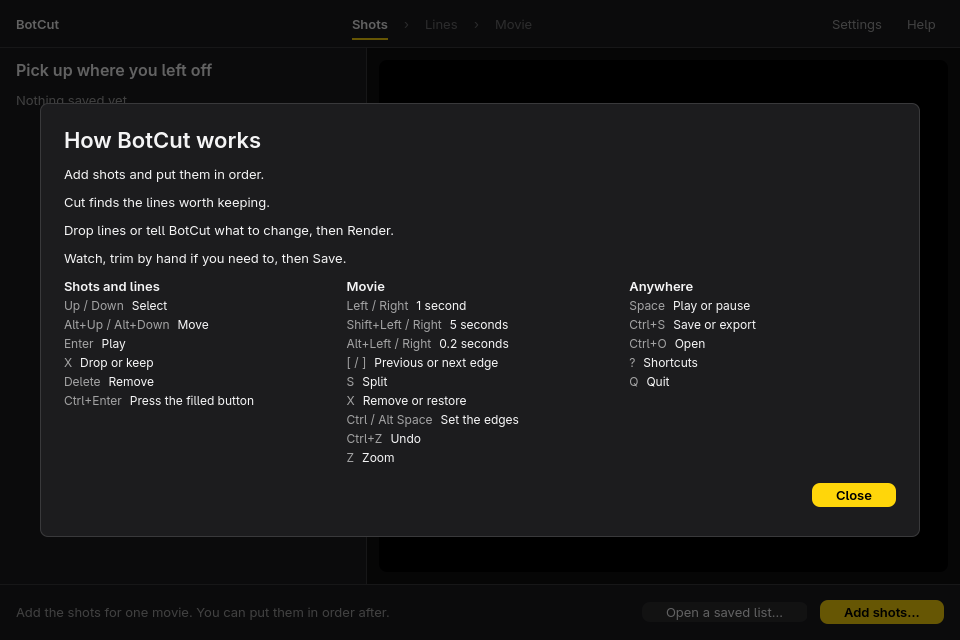
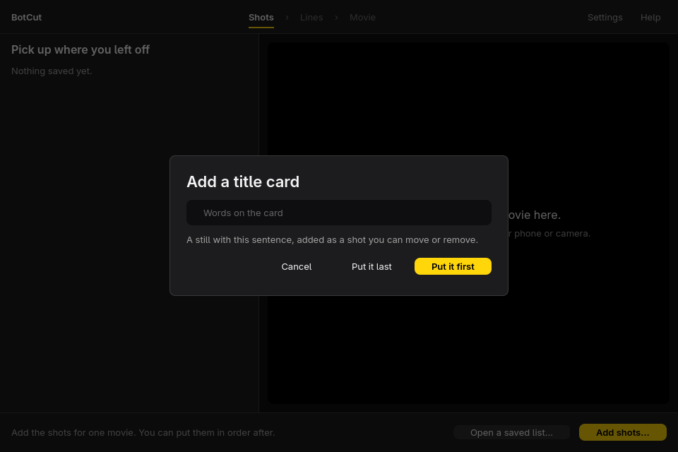
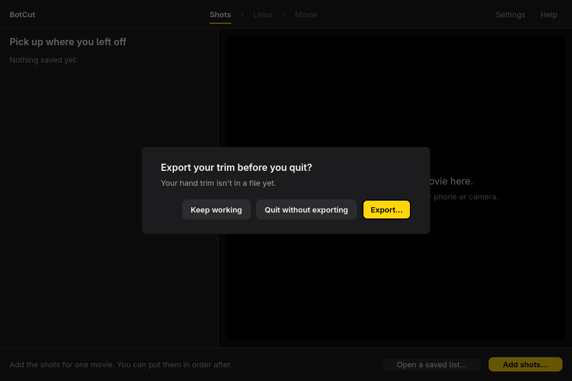
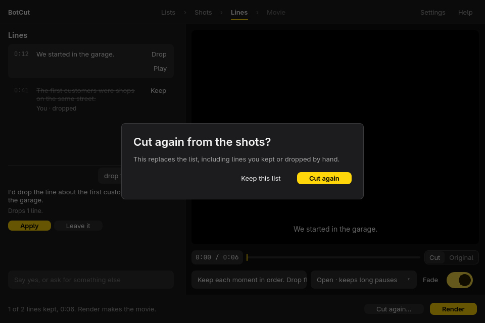

# BotCut

A fork of [Omacut](https://github.com/omacom/omacut) by David Heinemeier Hansson (MIT), extended with AI rough cuts from `botcut-cli`. Original copyright and license retained in `LICENSE`.

Drop the shots for one movie and BotCut cuts it: Grok keeps the lines worth saying, lays your B-roll over them, and ffmpeg renders the result. You change the cut by dropping or keeping lines, by asking in a chat, or by trimming the finished movie on a filmstrip. On Omarchy, the interface follows your theme's accent color.

Built using **Qt Quick (QML)** UI with the Material style — the same Qt stack Quickshell builds on — and **ffmpeg** for the cut. The C++ side compiles to a single executable; the QML is embedded in it via Qt resources.

The window is one plan, at least 960×640: the picture, the list for the step, and one next action. The left column and the chat under the lines drag to resize, and the sizes are remembered. These are the screens with the theme's corner radius.











## Trimming the movie

The filmstrip under a finished movie shows what it keeps, each range framed with a handle at both ends. Whatever falls outside every range is cut. Playback plays the ranges in order and skips the gaps.

- **Drag a handle** to trim that range.
- **Hover a range** and click its **×** to remove it.
- **Double-click a gap** to bring it back.

Handles catch on neighbouring ranges and the playhead.

## Hotkeys

- *Space*: Start/stop video playback.
- *Left/Right*: Move the playhead by 1 second.
- *Shift+Left/Right*: Move the playhead by 5 seconds.
- *Alt+Left/Right*: Move the playhead by 0.2 seconds.
- *[ / ]*: Jump to the previous / next clip edge.
- *X, Delete*: Remove the clip under the playhead; in a gap, restore it.
- *Ctrl+Space*: Move the start of the clip under the playhead to the playhead.
- *Alt+Space*: Move the end of the clip under the playhead to the playhead.
- *Ctrl+Z / Ctrl+Shift+Z*: Undo / redo.
- *Z*: Zoom to the clip under the playhead for fine tuning (Z again zooms back out).
- *Ctrl+S*: Save or export the current movie.
- *Q*: Quit (asks first if the edit hasn't been exported).
- *?*: Show the hotkeys in the app.
- On Shots and Lines: *Up/Down* move through the list, *Enter* plays a line, *X* drops or keeps it, *Alt+Up/Down* move a shot, *Delete* removes a shot, and *Ctrl+Enter* presses the filled button.

## Several videos

The window is one plan. The steps are Shots, Lines, and Movie. There is no sidebar. Drop videos or a folder onto the picture, or press **Add shots…**. Files added together are ordered oldest first, from the file's creation time. The selected shot plays in the picture. **Move up** and **Move down** show on the current row. **Remove** takes a file out. A missing file reads **File missing**, and **Cut** stays off until you remove it.

**Open a saved list…** is in the action bar at the bottom when the plan is empty. Under a shot list the actions are **Add shots…**, **Add a title card…**, and **Save list…**. **Save list…** writes the order, the cut mode, the movie line, which shots are B-roll or a second camera, and any lines. Dropping that file puts them back. **Lists**, at the left of the steps, goes back to that home. A hand trim that is not in a file yet asks before it leaves.

Spoken cuts are on by default. The shot list then holds one sentence for the movie and a pace that reads as a sentence, from **Open · keeps long pauses** to **Frenzied · cuts every breath**. **Add a title card…** opens a dialog. The field starts empty. The placeholder is **Words on the card**. **Put it first** or **Put it last** adds a still as a shot you can move or remove.

**B-roll**, on the selected row, marks that file as cover footage, and **Shot** marks it back. A B-roll file is not transcribed. The model lays it the way an editor would: in runs of three to twelve seconds over one or more lines, to hide a cut, to show what the words describe, or to rest the viewer, and never over the first line or the last. It says what it laid and why in the chat, and "less B-roll" or "none over the opening" there comes back as a change to apply. The first line of a run shows a still from the footage, the file, the run's length, and the reason; the lines under it read **B-roll goes on**. **Remove B-roll** on any of them takes the run off. Play on a line, or the kept lines in a row, shows the footage in the picture, across the cuts inside the run.

**Second camera**, on the selected row, marks that file as another camera on a take a file above it filmed, and **Shot** marks it back. You rarely need it: two files that heard the same take are found by their sound when you press **Cut**, and the second then reads **Second camera** in the list. A second camera is not transcribed and its sound is never played. The picture goes to it at a jump cut, at a new beat, on a line that carries the point, or after a long hold on one view, and never inside a line. The line where it changes shows a still from that camera and the reason, and the lines under it read **Second camera goes on**. **Stay on main** on any of them keeps that stretch on the first camera. In the chat, "cut between the cameras less" or "stay on the wide" comes back as a change to apply.

**Cut** makes the movie in one press: it transcribes the shots, reads the whole shoot, keeps the lines worth saying, reads the cut back and fixes what trips, lays the B-roll, renders, and saves the result in `~/Videos/BotCut` (set `BOTCUT_MOVIES_DIR` for another folder). A length named in the movie sentence, like "a ninety second update", is the length it cuts to. The chat opens with what the editor made of the cut, and under it the few spots worth a look, such as two lines that say the same thing or a line dropped though it is said nowhere else. A click on one goes to that line. It may move one line to the front to open the movie; that row reads **Opens the movie**, and **Put it back** returns it to its place. The window opens on the movie. **Lines**, in the steps at the top, is where you change it: **Drop** or **Keep** a line, and the filled button becomes **Update movie**, which renders over the same file and only makes the pieces that changed. Clicking a line shows that moment in the picture; the timeline under the picture only shows where playback is, and a click on it seeks. Under the lines is a chat. Ask for a change, and BotCut replies with what it would do: lines dropped or put back, a new movie sentence, a new pace, or the fade. Nothing changes until you press **Apply** or answer yes. **Leave it** drops the proposal. After a change lands, **Undo** on that turn puts the previous cut back. The command is `botcut-cli revise --propose`, then `revise --apply`. Spoken cuts need an xAI key. **Settings** stores that key in the keyring and never shows it again. Turning spoken cuts off keeps every file, in this order, and does not call the model.

On Movie the filmstrip is the trim. It is one block per kept range, and a handle edits that range in its own file. After a handle moves, the button reads **Update movie**. **Show the file**, **Captions**, **Vertical short**, and **Save a copy…** sit beside the sentence once the movie is up to date. Captions and the short land beside the movie. Each cut is a project under `~/.local/share/botcut/projects`, so a movie opened again from Recents still has its lines and can be changed. The command-line jobs are `botcut-cli run`, `render`, `revise`, `card`, `captions`, and `short`. See `cli/README.md`.

**Settings** is a dialog: spoken cuts, the xAI key, whether a B-roll shot's sound plays under the voice, and **Zoom**. Zoom is **Off** until you choose **Auto**. Auto goes closer at a cut between lines so the jump reads as a change of shot, goes closer on the few lines that carry the point, moves in slowly on a long wide stretch, and stays on a speaker who moves. Changing it makes the filled button **Update movie**. Fade is the switch under the picture. **Help** lists the shortcuts above. Quitting during a job, or with an unsaved movie or trim, asks first. **Cut again** asks before it replaces the line list.

## Install

Install this fork next to stock Omacut with `./bin/install`. The Arch package name is `botcut`.

## Requirements

- `xdg-desktop-portal` and a portal backend for the file picker
- `ffmpeg` and `ffprobe` on your PATH (used at runtime)
- `libsecret`, so the xAI key can be stored in the keyring

Exports are always written as MP4 files, regardless of the input video's container. The export dialog offers Original/1080p/720p quality — never upscaling, and always preserving the aspect ratio.

## Build

Uses Qt's own build tool, `qmake6` (no cmake needed):

```bash
./bin/build
```

This produces a single `botcut` binary in `build/`.

Requirements:

- A C++17 compiler and Qt6: `qt6-base`, `qt6-declarative` (Qt Quick + Controls),
  `qt6-multimedia`
- `libsecret`

## Test

```bash
./bin/test
```

## Package

Build and install the local Arch package on this machine:

```bash
./bin/install
```

This runs `./bin/build`, then `makepkg -fsi` from `pkgbuild/` so same-version local packages are rebuilt and reinstalled. Extra arguments are passed through to `makepkg`, for example `./bin/install --clean`. The package installs the window (`/usr/bin/botcut`), the desktop entry, the app icon, and the MIT license. It does not install `botcut-cli`. Spoken cuts, revise, cards, captions, and short look for `botcut-cli` in `BOTCUT_CLI`, then on `PATH`, and otherwise run it through `uv` from the `cli` folder of the checkout the window was built from (`BOTCUT_CLI_PROJECT` names another). Local package outputs such as `pkgbuild/pkg/`, `pkgbuild/src/`, and `*.pkg.tar.*` are ignored.

No GitHub release has been published. How a later release would be built and attached is in `docs/github-release.md`. Do not treat `./bin/install` as that release.

## License

MIT. See `LICENSE`.
