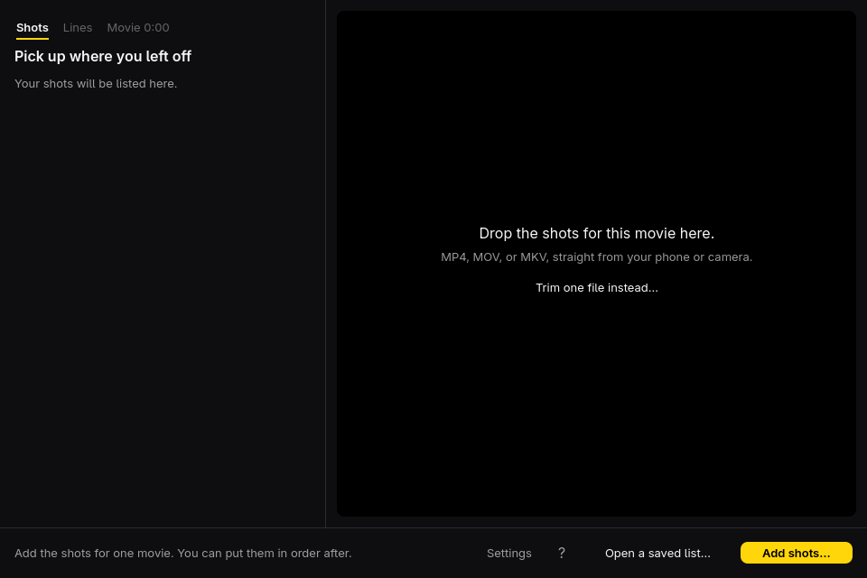
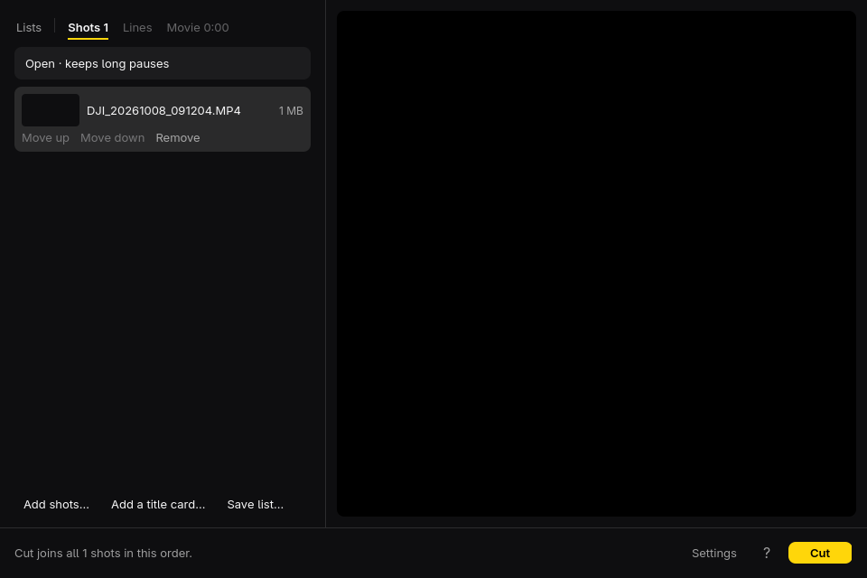
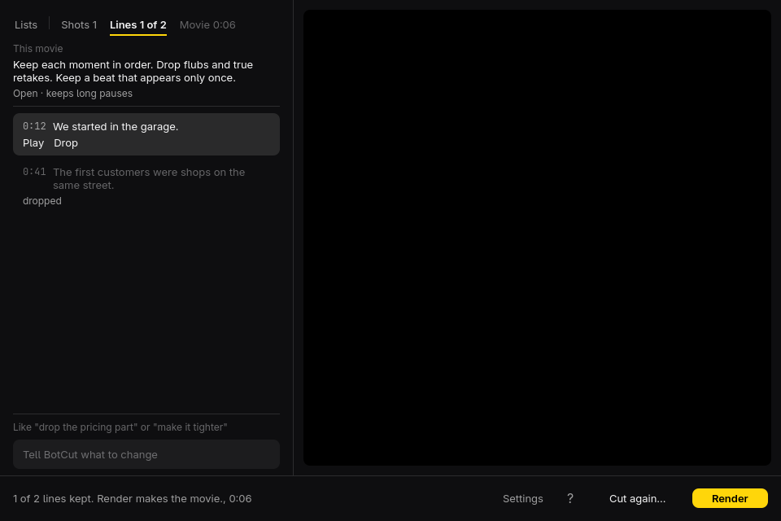
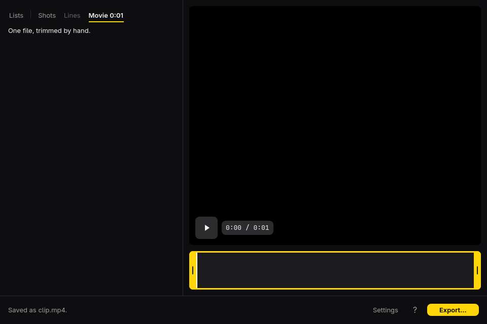
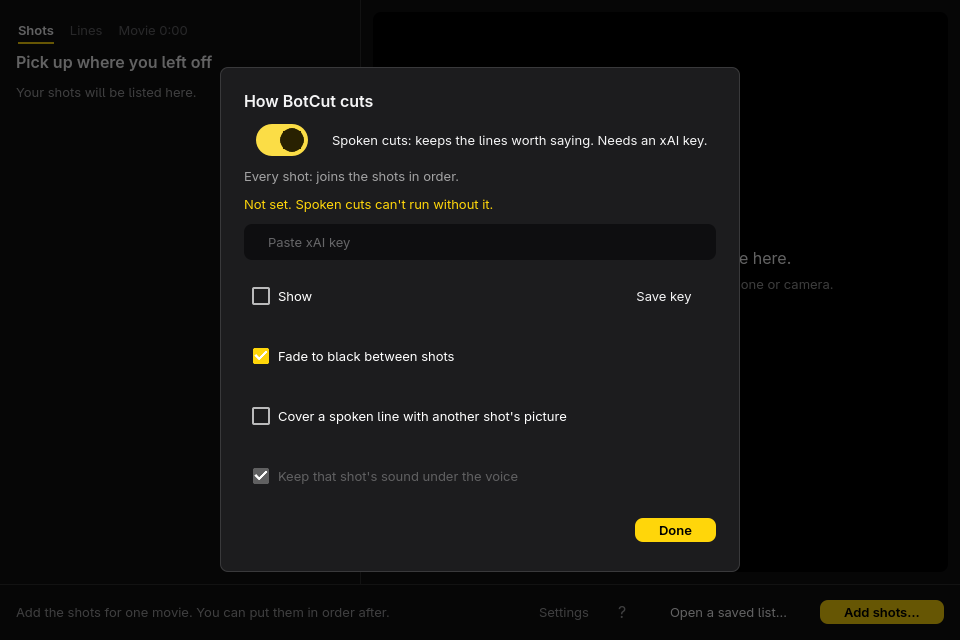
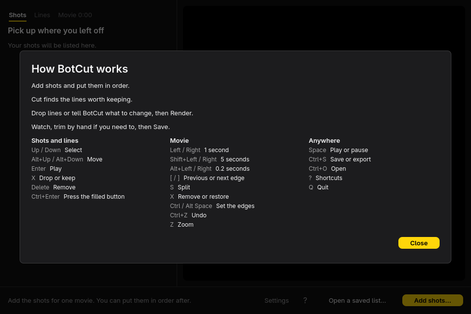
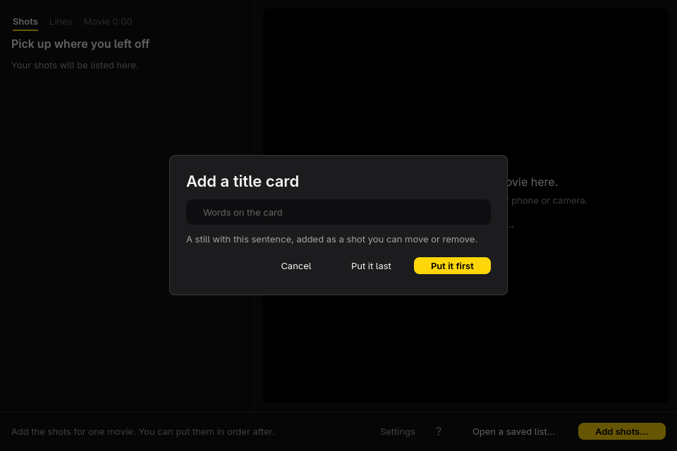
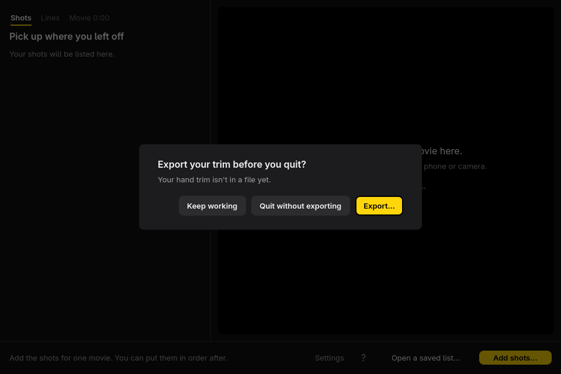
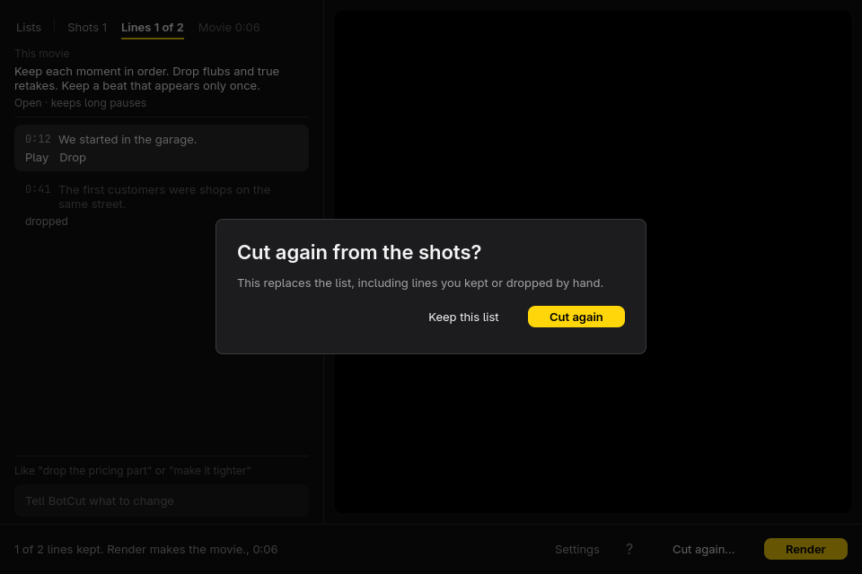

# BotCut

A fork of [Omacut](https://github.com/omacom/omacut) by David Heinemeier Hansson (MIT), extended with AI rough cuts from `botcut-cli`. Original copyright and license retained in `LICENSE`.

A dead-simple video trimmer, with a shot tray that can rough-cut several videos before you trim. Open a video, trim either end, split it into clips and cut ranges out of the middle, preview the result, and export. On Omarchy, the interface follows your theme's accent color.

Built using **Qt Quick (QML)** UI with the Material style — the same Qt stack Quickshell builds on — and **ffmpeg** for the cut. The C++ side compiles to a single executable; the QML is embedded in it via Qt resources.

The window is one plan, at least 960×640. These are the screens with the theme's corner radius.











## Editing

The timeline shows your video as one or more clips, each framed with a handle at both ends. Whatever falls outside every clip is cut. Playback plays the clips in order and skips the gaps.

- **Double-click a clip** to split it there.
- **Drag a handle** to trim that clip. Dragging the handles at a split apart removes the part between them.
- **Double-click a gap**, or the line between two touching clips, to join them again.
- **Hover a clip** and click its **×** to remove it.

Handles catch on neighbouring clips and the playhead.

## Hotkeys

- *Space*: Start/stop video playback.
- *Left/Right*: Move the playhead by 1 second.
- *Shift+Left/Right*: Move the playhead by 5 seconds.
- *Alt+Left/Right*: Move the playhead by 0.2 seconds.
- *[ / ]*: Jump to the previous / next clip edge.
- *S*: Split the clip at the playhead.
- *X, Delete*: Remove the clip under the playhead; in a gap, restore it.
- *Ctrl+Space*: Move the start of the clip under the playhead to the playhead.
- *Alt+Space*: Move the end of the clip under the playhead to the playhead.
- *Ctrl+Z / Ctrl+Shift+Z*: Undo / redo.
- *Z*: Zoom to the clip under the playhead for fine tuning (Z again zooms back out).
- *Ctrl+O*: Open a new file to trim.
- *Ctrl+S*: Save or export the current movie.
- *Q*: Quit (asks first if the edit hasn't been exported).
- *?*: Show the hotkeys in the app.

## Several videos

The window is one plan. The steps are Shots, Lines, and Movie. There is no sidebar. Drop videos or a folder onto the picture, or press **Add shots…**. Files added together are ordered oldest first, from the file's creation time. The selected shot plays in the picture. **Move up** and **Move down** show on the current row. **Remove** takes a file out. A missing file reads **File missing**, and **Cut** stays off until you remove it.

**Open a saved list…** is in the footer when the plan is empty. Under a shot list the actions are **Add shots…**, **Add a title card…**, and **Save list…**. **Save list…** writes the order, the cut mode, the movie line, and any lines. Dropping that file puts them back. **Lists**, at the left of the steps, goes back to that home. A hand trim that is not in a file yet asks before it leaves.

Spoken cuts are on by default. The shot list then holds one sentence for the movie and a pace that reads as a sentence, from **Open · keeps long pauses** to **Frenzied · cuts every breath**. **Add a title card…** opens a dialog. The field starts empty. The placeholder is **Words on the card**. **Put it first** or **Put it last** adds a still as a shot you can move or remove.

**Cut** transcribes the shots and lists the lines it would keep. **Drop** or **Keep** a line, then **Render** encodes `rough_cut.mp4`. The field at the bottom of the line list is the chat. **Change this cut**, inside that field, sends a note about the plan. The reply can change the sentence, the pace, the fade, and which lines stay. It does not encode. **Undo this change** puts the previous cut back. The command is `botcut-cli revise`. Spoken cuts need an xAI key. **Settings** stores that key in the keyring and never shows it again. Turning spoken cuts off keeps every file, in this order, and does not call the model.

**Trim one file instead…**, or Ctrl+O, opens one video on Movie. The filmstrip is the trim. **Save…** copies an unedited cut. **Export…** re-encodes a hand trim. On a plan cut the filmstrip is one block per kept range, and a handle edits that range in its own file. An untouched plan still saves by copying. After a handle moves, the button reads **Export…**. **Captions** and **Vertical short** stay after a save, because the app remembers the project `cuts.json`. They wait until a trimmed plan has been exported. Opening a different video clears them. The command-line jobs are `botcut-cli run`, `render`, `revise`, `card`, `captions`, and `short`. See `cli/README.md`.

**Settings** is a dialog: spoken cuts, the xAI key, **Fade to black between shots**, and covering a line with another shot's picture. **Help** lists the shortcuts above. Quitting during a job, or with an unsaved movie or trim, asks first. **Cut again** asks before it replaces the line list.

## Keep-lists

`botcut file.keep.json` opens that video with the keep ranges already laid out as clips. Ctrl+Z once restores the full source.

```json
{"source": "master.mp4", "keep": [{"start": 1.25, "end": 4.8, "label": "optional, ignored"}]}
```

Times are seconds in the source. A relative `source` resolves against the directory that contains the JSON file. Labels are ignored.

## Install

Install this fork next to stock Omacut with `./bin/install`. The Arch package name is `botcut`.

## Requirements

- `xdg-desktop-portal` and a portal backend for the file picker
- `ffmpeg` and `ffprobe` on your PATH (used at runtime)
- `libsecret`, so the xAI key can be stored in the keyring

Exports are always written as MP4 files, regardless of the input video's container. The export dialog offers Original/1080p/720p quality — never upscaling, and always preserving the aspect ratio.

## Build

Uses Qt's own build tool, `qmake6` (no cmake needed):

```bash
./bin/build
```

This produces a single `botcut` binary in `build/`.

Requirements:

- A C++17 compiler and Qt6: `qt6-base`, `qt6-declarative` (Qt Quick + Controls),
  `qt6-multimedia`
- `libsecret`

## Test

```bash
./bin/test
```

## Package

Build and install the local Arch package on this machine:

```bash
./bin/install
```

This runs `./bin/build`, then `makepkg -fsi` from `pkgbuild/` so same-version local packages are rebuilt and reinstalled. Extra arguments are passed through to `makepkg`, for example `./bin/install --clean`. The package installs the window (`/usr/bin/botcut`), the desktop entry, the app icon, and the MIT license. It does not install `botcut-cli`. Spoken cuts, revise, cards, captions, and short look for `botcut-cli` on `PATH`, and otherwise for `uv` with `~/code/botcut/cli`. Local package outputs such as `pkgbuild/pkg/`, `pkgbuild/src/`, and `*.pkg.tar.*` are ignored.

No GitHub release has been published. How a later release would be built and attached is in `docs/github-release.md`. Do not treat `./bin/install` as that release.

## License

MIT. See `LICENSE`.
